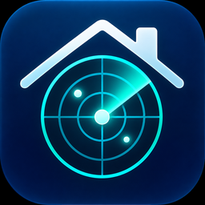

# Jarvis Room Configurator v0.7.0



An optional Home Assistant Marketplace / HACS **Dashboard plugin** for existing
ESPHome LD2460 roomnodes. No Python integration, configuration flow or Helper is
required. This migration retains the existing target card and its configuration.

## Installation

Add `https://github.com/martijnkoot/jarvis-room-configurator` as a custom
repository in Marketplace / HACS with type **Dashboard** (backend category
`plugin`), then download it. This is not a claim of inclusion in the default catalog.
Use a version containing the v0.7.0 layout; old v0.6.x releases are integrations.
A feature branch / PR is not a published Marketplace upgrade.

Check the dashboard resources after installation. There must be exactly one
JavaScript module for this card. HACS normally registers the resource; if it does
not, add `/hacsfiles/jarvis-room-configurator/jarvis-room-configurator.js` manually.
The underlying file is installed in `www/community/jarvis-room-configurator/`.
For manual installation, copy `dist/jarvis-room-configurator.js` to that directory
and add `/local/community/jarvis-room-configurator/jarvis-room-configurator.js`
as a JavaScript module. Reload the browser after changing resources.

```yaml
type: custom:jarvis-target-card
title: Kantoor — LD2460
entity_prefix: sensor.kantoor_
range: 5
flip_x: true
flip_y: true
smoothing_ms: 180
trail_seconds: 8
```

Choose a prefix matching **one** roomnode. Target entities must end in
`tracking_target_N_x` / `_y` or `target_N_x` / `_y` (N = 1–5), with units
`m`, `cm` or `mm`. Missing/unsupported units and unavailable targets are not plotted.
`range` is the display scale in metres, not a device setting. Flips affect only
the display. Smoothing (0–2000 ms) and trails (0–60 seconds) are visual only;
tracking IDs and trails do not establish a person's identity.

## Zones and editing

The card displays four detection zones and two exclusions simultaneously, plus
firmware-reported counts. It reads existing `text.<prefix>*polygon_zone_1..4`
and `text.<prefix>*polygon_exclusion_1..2` entities. Counts use
`sensor.<prefix>*polygon_zone_N_target_count` or `*zone_N_target_count`.
Missing or ambiguous matches are not guessed.

Select a zone, choose **Draw new**, add 3–20 vertices and **Finish**; drag vertices
to refine it. **Clear** previews deletion and **Reload** discards the draft.
Only **Apply to ESPHome** calls Home Assistant `text.set_value` for the selected
entity, using firmware format `Xmm:Ymm;Xmm:Ymm`. An empty polygon clears it.
The roomnode's existing polygon firmware package must already be installed.
ESPHome text states are optimistic: a successful service call does not prove
persistent storage. Check the entity state and verify persistence by restarting
the roomnode when appropriate. Drafts and trails are not persisted by the card.

## Migrating from v0.6.x

1. Back up Home Assistant and record the existing card YAML, resources and zone
   text values. Keep the old integration version available for rollback.
2. Plan a maintenance window. Remove the old integration/config entry through
   supported Home Assistant controls while its Python code is still available,
   then remove its Marketplace installation. Restart Home Assistant as required.
3. Add/download the repository as **Dashboard**, using a version with the new
   distribution layout. Replace the old `/jarvis_room_configurator/target-card.js`
   resource (including version queries) with the new module URL above. Do not
   load both resources. Keep the card YAML unchanged and reload the browser.
4. Verify live targets, both flips, smoothing, trails, all polygons and counts.
   If a write test is desired, explicitly apply a recorded zone and verify its
   state and persistence. Installation itself must not write device settings.

**Known leftover Helper:** an old entry registered as a Helper may show
`Invalid handler specified` and may not be removable through its normal UI.
The Dashboard plugin cannot repair or delete that backend entry. If supported
removal fails, stop that cleanup and handle it separately before removing the
old Python files; retain a backup and the old version for recovery. Do not edit
`.storage` or assume uninstalling the repository removes its config entry.
No live Home Assistant cleanup is performed by this repository migration.

To roll back, remove the new module resource, restore the previous integration
version and its resource, restart Home Assistant and reload the dashboard.
Avoid loading both versions of `jarvis-target-card` together.

## Independence and limitations

ESPHome owns radar settings, stored polygons and occupancy; the card uses
`hass.states` and the standard `text.set_value` service. It has no private
backend API, imports or runtime asset dependencies. The removed Python layer
only served the old JavaScript URL. Removing this plugin does not send any
commands or erase device polygons. Remove its dashboard cards and resource too.
See [ADR-001](docs/ADR-001-independence.md).

The view assumes side/wall mounting with forward-positive Y. Ceiling projection,
floor plans and multi-sensor calibration are not implemented. Automated tests
cover standalone loading and core behavior with simulated Home Assistant states;
they do not establish real browser rendering, HACS installation or firmware
persistence. Verify these in a test installation before production migration.

## Development and validation

No frontend build or dependencies are required; `dist/jarvis-room-configurator.js`
is the maintained source and distributable. Run from the repository root:

```sh
node --check dist/jarvis-room-configurator.js
node --test tests/*.test.cjs
python3 -m unittest discover -s tests -v
```

CI also runs `hacs/action` with `category: plugin`. Hassfest is not applicable to
this JavaScript distribution. Python is only used for repository tests.
No release is created automatically by these workflows. For a future v0.7.0
release, tag the reviewed commit with this layout; if publishing a release
asset, use the exact filename `jarvis-room-configurator.js` from `dist/`.

## License

See [LICENSE](LICENSE). No SmartHomeShop source is included.

## Radar field of view (feature; no new release)

The cyan fan is a **schematic hardware envelope**, separate from detection and
exclusion polygons. It defaults to 6 m and 120° (±60°), based on
[Hi-Link's LD2460 specifications](https://www.hlktech.com/en/Goods-345.html).
A circular sector is an approximation, not a measured coverage boundary: motion,
stationary presence, edge angles, mounting, enclosure and obstructions affect
actual detection. It must not be used as evidence that a person will be detected.

```yaml
show_fov: true       # false hides the fan and its legend
fov_range: 6         # metres, >0..6; visual hardware-envelope assumption
fov_angle: 120       # degrees, >0..120; visual hardware-envelope assumption
```

The origin is the radar's local `(0, 0)` position, forward is +Y, and positive
bearing points toward +X. The fan is centred on +Y with metre arcs and a direction
arrow. Both flips apply to every point, including arcs and the arrow. There is
no separate world-position or rotation setting: this is a single-radar local
view. Adding an independent rotation would misalign the raw target coordinates.
`range` still changes display scale only. The existing square viewport can crop
the fan (especially with the default 5 m scale); the legend explicitly warns
about this. No automatic rescaling changes target positions or editing behavior.

A dashed grey sector additionally shows **configured radar limits**, when all
three unique `number.<prefix>*tracking_radar_detection_distance`,
`*tracking_radar_detection_start_angle` and `*tracking_radar_detection_end_angle`
entities exist with valid units (`m`/`cm`/`mm`, and `°`). Limits must fit side-mode
bounds: >0..6 m and -60° ≤ start < end ≤ 60°. Missing, unavailable, ambiguous or
invalid values omit only this grey sector; they never change the hardware fan.
It is neither an occupancy polygon nor a guarantee of coverage.

The inspected ESPHome `tracking-ld2460.yaml` exposes these names; its component
publishes detection-range replies to the number entities, validates side-mode
limits above, and calculates target bearing as `atan2(x, y)`. The installation
mode select uses raw values `side` and `top`. A unique
`select.<prefix>*tracking_radar_installation_mode` must report `side` if present;
otherwise FOV rendering is suppressed, including for ambiguous/unavailable modes.
If absent, the existing card's side-mount assumption is used. Installation height
and downward tilt are deliberately not treated as horizontal bearing: ceiling
and floor-plane projection remain unsupported. Custom renamed entities may
prevent automatic discovery. No settings are sent to ESPHome by this feature.
