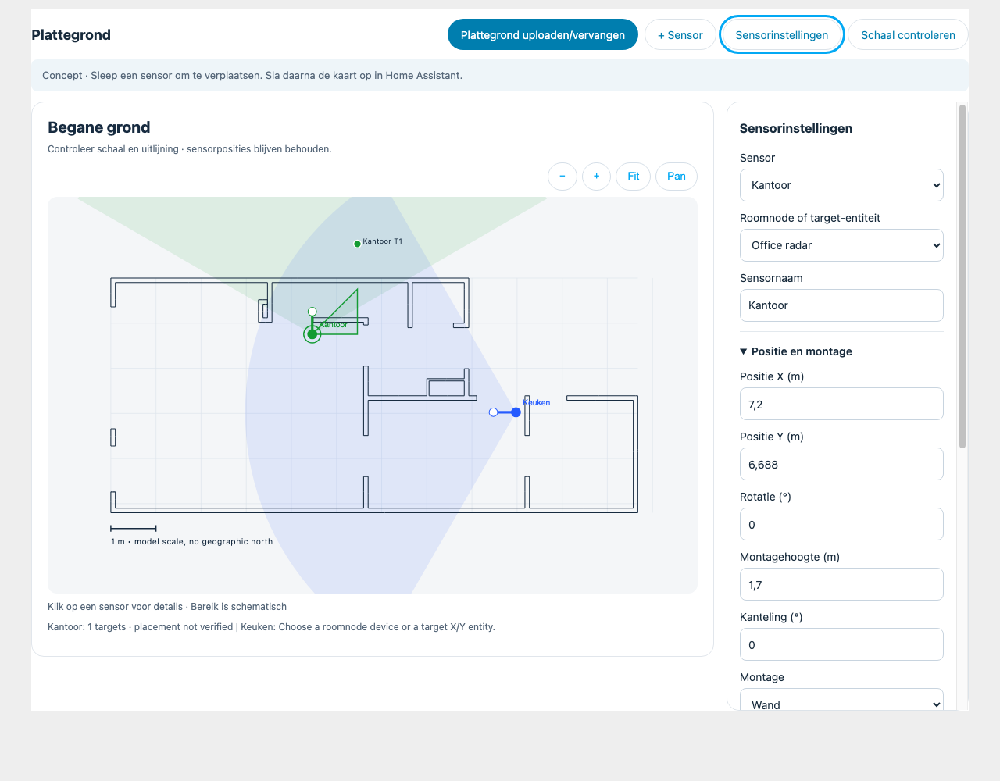
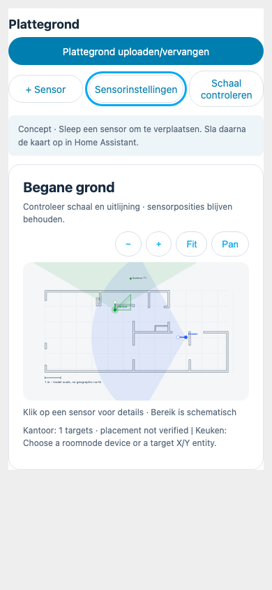

# Floorplan workspace

The floorplan is the main workspace. Above it, **Plattegrond uploaden/vervangen**,
**+ Sensor**, **Sensorinstellingen**, and **Schaal controleren** are always visible
in the visual Lovelace editor. Click a sensor to select it; a ring marks selection.
Drag its coloured marker to move, or its white handle to rotate. Numeric fields
provide the same controls without dragging. No JSON is needed for normal setup.

The selected sensor panel appears on the right when the editor container is wider
than 800 px; on smaller containers it is a bottom drawer with Close and Escape.
Position/mounting, coverage/axes, and movement/trails are separate groups. Source
selection still discovers all matching targets and polygons automatically. The
polygon editor remains an explicit expandable tool with its own Apply action.

At runtime, sensor details open in a right-hand modal panel (bottom drawer below
600 px). Persistent source and placement editing still follows HA's visual card
editor and Save workflow. Runtime polygon Apply retains its explicit hardware
write. This avoids relying on a private dashboard write API.

## Replace a floorplan

This is a URL-based replacement workflow, **not an upload to HA from the card**.
The dialog says this before asking for a URL. There is no temporary file picker,
localStorage or base64 document embedded in dashboard configuration.

1. Copy a trusted SVG, PNG or JPG into `config/www` using your existing HA file
   management tool (File editor, Studio Code Server, Samba, etc., if installed).
   When creating `www` for the first time, HA may need a restart; the card does
   not create folders or restart HA. For example `config/www/house-v2.png`
   becomes `/local/house-v2.png`. Use a new filename to avoid stale browser caches.
2. Open **Plattegrond uploaden/vervangen** and enter that path. A stable direct
   HTTPS image URL also works. Remote hosting must permit image embedding and
   be reachable from every dashboard client. Credentials in URLs, HTTP URLs,
   data/blob URLs, media-source IDs, temporary download URLs and HTML pages are
   not supported. URL extensions must be `.svg`, `.png`, `.jpg` or `.jpeg`.
3. Enter the real width and height of the *entire image*, including margins.
   Do not use just the room dimensions if the image has borders. Each dimension
   sets its corresponding image axis; wrong proportions distort the plan.
4. X/Y origin translates the image in **map metres**, right/down, and rotation
   turns it clockwise about its top-left corner. These are deliberately separate
   from the historical sensor world X/Y fields. Start at X=0/Y=0/rotation=0 for
   a new house; use these alignment fields to register an updated drawing against
   existing sensors. Sensor positions and raw firmware polygons never move as
   a side effect. There is no implicit sensor reset or automatic alignment.
5. **Controleren en gebruiken** loads and decodes the image before emitting a
   new dashboard draft (10 s timeout; images over 40 megapixels rejected). Invalid
   values, failed loading or cancellation preserve the old configuration.
   SVG is used only as an SVG `<image>` resource, never injected as markup.
   External resources and active SVG content are subject to browser image rules;
   prefer self-contained SVG with explicit dimensions, or rasterize complex SVG.
6. Review with **+**, **−**, **Fit**, and **Pan**. Pan is an explicit mode so normal
   page scrolling remains available; dragging sensor icons still edits the sensor.
   Navigation is temporary and does not change the saved image or sensor scale.
   Fit includes all four rotated image corners, not all sensor coverage sectors.
   Sensors outside the new image remain at their saved positions; zoom out/pan to
   reach them. Replacement is a drawing change, not room recognition.
7. Verify two independent real distances and at least three known positions.
   **Schaal controleren → Gecontroleerd** records a visual acknowledgement only.
   Image replacement, resizing, translation, rotation and restoring the original
   drawing clear that acknowledgement. Individual sensor verification flags are
   retained, but do not certify a new drawing. Check each physical sensor again.
8. Save the card/dashboard in HA, reload and check the result on another device.
   YAML dashboards require saving YAML through their normal workflow. The file
   itself must remain at its URL and is not part of a dashboard backup.

**Originele plattegrond** restores the bundled Blender drawing while keeping all
sensor placements, device links, options and polygons. Cancel the HA editor to
abandon a draft replacement. Existing cards without `floorplan_image` keep their
original geometry and need no migration. Old radar-card import remains available
under the selected sensor's panel.

### Storage and privacy limits

Home Assistant documents `/local` as the supported static-file route, but those
files **are not protected by HA authentication**. Do not put confidential plans
there. HA's `file_upload` integration is a building block consumed by other
integrations, not a documented generic durable file store for Dashboard plugins.
A frontend-only card cannot assume an upload ID becomes a permanent static URL.
This feature therefore uses the documented hosted-image route and does not call
internal upload, media-management or private Lovelace APIs. Media source IDs and
expiring signed URLs would require a separate supported resolver/lifecycle design.

Sources reviewed 2026-11-06:

- [HTTP: Hosting files](https://www.home-assistant.io/integrations/http/#hosting-files)
- [File upload building block](https://www.home-assistant.io/integrations/file_upload/)
- [Media source platform](https://developers.home-assistant.io/docs/core/platform/media_source/)

## Screenshots

These are isolated browser fixtures with simulated HA entities, not a live HA
installation. The dark view uses HA theme variables. See the validation report
([validation report](workspace-validation.md)) for actual viewport sizes and remaining physical/runtime acceptance checks.

| Desktop workspace | Mobile overview |
| --- | --- |
|  |  |

[Dark workspace](screenshots/workspace-dark.png) ·
[Mobile drawer](screenshots/workspace-drawer.png) ·
[Replacement dialog](screenshots/workspace-replace.png) ·
[Previous PR #5 layout](screenshots/workspace-before.png)
